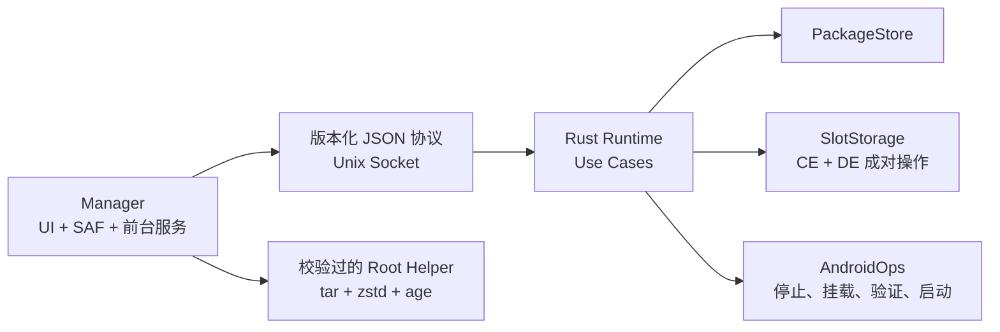

# UClone Slices

[](https://github.com/gkeyes/uclone-slices/actions/workflows/ci.yml)
[](LICENSE)

UClone Slices 是一款适用于 Root Android / KernelSU 设备的多账号空间管理工具。它可以为同一个 App 创建多个独立账号空间，并在账号之间快速切换。

当前开发候选版为 **v0.3.8**，Runtime 协议 ID 为 `0.3.8`。启动校验各层期限改为嵌套（Runtime 挂载 4 秒、companion 9 秒、App 9.5 秒），系统忙时不再因同为 5 秒的计时误杀启动；companion 放弃等待时 App 立即失败；保留 0.3.7 的修正：开机先绑定启动通道并等待系统框架连上再收敛，“重启后启动”与中断的备份恢复不再因系统尚未连接而失败；Root 与原生端只接受由 Root 提供的启动通道；保留 0.3.6 的修正：系统框架 Hook 单次出错只影响那一次启动，不再停用到重启；准备账号超过 0.3 秒显示进度和取消，30 秒未完成自动放弃；保留 0.3.5 的可用性修正：单个损坏的账号记录不再让其他 App 无法启动；切换中点开 App 不再断开整条系统连接；停用或移除模块后不再拦截原来登记的 App；保留 0.3.4 的启动门禁锁顺序修正；保留 0.3.3 的共享挂载隔离和运行异常 App 的账号列表；保留 Xposed API 102、启动前默认账号门禁和按进程固定的 CE/DE 视图；Manager 与 KernelSU 模块需成对更新，启用 Vector 的系统框架作用域并重启。完整真机行为验收状态见 [docs/DEVICE_QA.md](docs/DEVICE_QA.md)。

## 功能

- 同一个 App 可保存系统原始空间和多个独立分账号。
- 可创建空白分账号，也可复制系统原始空间。
- 点击账号即可完成切换并打开 App。
- 每个 App 可选择默认账号；外部打开或真正离开后返回时自动回默认，Slice 内选择的账号在当前会话有效。拍照、文件选择、支付和锁屏等临时流程返回时保留当前账号。
- 支持重命名、删除分账号，以及取消应用配置。
- 支持备份或恢复 Base、单个分账号和全部账号，备份默认使用密码加密。
- 三角洲行动会自动跳过可重新下载的游戏资源；恢复到已有空间时保留本地资源，只覆盖账号数据。
- 切换、备份和恢复时会自动停止并校验 App，避免账号数据混用。
- App 升降级和设备重启后保留账号配置，并可选择重启后自动打开 App。
- 备份只保存账号所需的私有数据，不包含 APK、缓存、媒体和外部存储文件。

## 运行条件

| 项目 | 当前范围 |
|---|---|
| Android | Manager 可安装于 Android 10 / API 29 及以上；0.3.x 的启动前切换（系统框架 Hook）需要 Android 13 / API 33 及以上，更低版本不安装该 Hook；当前真机为 Android 17 / API 37 |
| CPU | arm64 |
| Root | KernelSU，能够加载模块并授予 Manager 权限 |
| 用户 | 已解锁的 user0 |
| 注入框架 | Vector（libxposed API 102）及 Zygisk API 4 |
| App | 具有 Launcher 入口的普通第三方 App |

暂不支持工作资料、第二用户、system/shared-UID App，或 UID/签名不兼容的替换安装。身份不兼容时旧空间会被保护，不能自动接管。

## 下载与安装

Release 产物由 GitHub Actions 从同一提交 SHA 生成：

1. `uclone-slices-manager-<version>-<sha>.apk`
2. `uclone-slices-kernelsu-<version>-<sha>.zip`
3. `SHA256SUMS.txt`

安装步骤：

1. 安装 Manager APK。
2. 在 KernelSU 中刷入模块 ZIP。
3. 重启手机并解锁 user0。
4. 打开 Manager，授予 Root 权限，确认标题旁的状态点为绿色；运行环境页显示 Runtime 版本 `0.3.8`（协议 ID）且启动前切换已就绪。

Release APK 使用固定证书签名，CI 会校验证书；覆盖安装即可，不要卸载或清数据。

## 基本使用

1. 点击首页标题栏的“添加”图标，选择需要管理的 App。
2. 登记后进入详情页，创建空白空间或原始空间副本。
3. 返回首页，点击应用下方的空间按钮即可切换并启动 App；进度显示在被点的按钮上。
4. 当前空间使用西瓜红高亮；再次点击当前空间只重新启动 App。
5. 普通空间可在详情页重命名或删除。
6. 已配置 App 的菜单可开启“重启后自动切换并打开 App”；默认关闭时重启恢复只切换空间，不启动 App。
7. 应用详情页的“默认账号”可选择原始空间或任意已有账号，也可关闭；删除默认账号会同时关闭自动回默认。详细规则见 [默认账号与前台会话](docs/DEFAULT_ACCOUNT.md)。
8. 首页标题栏的“备份”图标进入“备份与恢复”，可备份全部账号、单独备份 Base 或单独备份一个分账号，页面和通知显示完成百分比。
9. 恢复时选择 `.ucsbackup`，输入密码并核对来源；Base 目标固定，分账号可覆盖现有分账号或恢复为新分账号。
10. 同一菜单可执行“取消配置并移除分空间”。

取消配置会切回 Base 并移除登记记录，UClone 管理的独立 CE/DE 空间不会立即删除，而是移入回收区保留 7 天，之后由 Runtime 在开机协调或下一次取消配置时永久删除。取消配置不卸载 App，也不删除系统原始数据。

## 架构



- `PackageAggregate` 仍是唯一稳定业务状态；备份/恢复只增加可清理的事务 intent/result sidecar。
- Use Case 完整处理操作顺序和中断恢复。
- Manager 负责 SAF、归档、压缩、加密、预览和结果展示，不直接切换或替换账号目录。
- KernelSU Shell 收紧控制面权限，并从 init 派生独立 slave mount namespace 启动 Runtime；namespace anchor 在 daemon 重启期间保留事务视图。
- Vector 在系统启动入口和业务 Application 绑定前执行门禁；Zygisk companion 在业务代码运行前固定每个配置 App 进程的 CE/DE 视图。
- 启动许可、进程证明和临时会话均为当前启动的派生状态，账号真相仍只有 Aggregate。
- Runtime 只保留 `PackageStore`、`SlotStorage`、`AndroidOps` 三个底层端口。

当前 wire 有十九个操作：

`probe`、`list_packages`、`get_package`、`enroll`、`rebind_package`、`create_slot`、`activate_slot`、`rename_slot`、`delete_slot`、`unenroll`、`set_launch_after_reboot`、`set_default_slot`、`begin_backup_io`、`finish_backup_io`、`begin_restore_io`、`commit_restore_account`、`finish_restore_io`、`abort_account_io`、`list_account_io_status`

`probe` 保持旧格式；其余请求必须携带与 Runtime 精确匹配的稳定协议 ID。以后只新增 App 备份规则时，可以只升级 Manager。

错误码为：

`invalid_request`、`not_found`、`state_conflict`、`identity_mismatch`、`operation_failed`、`io_busy`、`backup_invalid`、`backup_password_required`、`backup_auth_failed`、`insufficient_storage`、`backup_incompatible`

## 仓库结构

- `runtime/`：Rust 聚合、Use Case、端口、生产适配器和 socket 入口。
- `manager-app/`：Compose Manager。
- `protocol/fixtures/`：Rust 与 Kotlin 共用的协议 fixtures。
- `kernelsu/`：KernelSU 模块启动层。
- `native/`：Zygisk 接入、进程视图 worker 与 namespace anchor。
- `docs/`：开发约束、设置来源、真机验收和 ADR。
- `tools/`：构建与校验脚本，以及只读设备诊断脚本 `diagnose-runtime.sh`。

## 构建与验证

需要 JDK 17、Android SDK 37、Build Tools 37.0.0、NDK 29.0.14206865、Rust 1.95 和 Android arm64 target。

```bash
cargo fmt --all -- --check
cargo test --workspace --all-targets --locked
cargo clippy --workspace --all-targets --locked -- -D warnings
RUSTDOCFLAGS="-D warnings" cargo doc --workspace --no-deps --locked

ANDROID_NDK_HOME=/path/to/android-ndk ./tools/build-manager-helper.sh
ANDROID_NDK_HOME=/path/to/android-ndk ./tools/build-native.sh
# Production module + companion callbacks across UID changes and loader FD cleanup
./tools/test-native-lifecycle.sh
# Linux disposable namespaces, requires sudo and g++ static libraries
./tools/test-native-namespaces.sh

./gradlew --no-daemon \
  :manager-app:testDebugUnitTest \
  :manager-app:lintRelease \
  :manager-app:assembleRelease

./tools/check-decision-alignment.sh
./tools/test-kernelsu.sh
ANDROID_NDK_HOME=/path/to/android-ndk ./tools/build-kernelsu.sh
```

真机验证步骤见 [docs/DEVICE_QA.md](docs/DEVICE_QA.md)。问题必须先由稳定失败的测试或只读诊断确认，再修改生产代码。

## 数据位置

- 聚合状态：`/data/adb/uclone-slices-v2/packages/<package>/aggregate.json`
- 取消配置回收区记录：`/data/adb/uclone-slices-v2/packages/<package>/trash-intent.json`
- 签名身份：`/data/adb/uclone-slices-v2/packages/<package>/binding-v1.json`
- 重绑 journal：`/data/adb/uclone-slices-v2/packages/<package>/rebind-intent.json`
- 备份/恢复 journal：`/data/adb/uclone-slices-v2/packages/<package>/account-io-intent-v1.json`
- 最近恢复结果：`/data/adb/uclone-slices-v2/packages/<package>/account-io-result-v1.json`
- 首次迁移备份：`/data/adb/uclone-slices-v2/state-backups/pre-0.1.7/<package>/`
- CE 空间：`/data/misc_ce/0/uclone-slices-v2/slots/<package>/<slot>`
- DE 空间：`/data/misc_de/0/uclone-slices-v2/slots/<package>/<slot>`
- Runtime socket：`/data/adb/uclone-slices-v2/runtime.sock`
- 恢复暂存和回滚：CE/DE UClone 根下的 `transfers`、`maintenance`、`rollback`，事务完成或恢复后统一清理。
- 回收区：取消配置时先把 CE、DE 各自的 `slots/<package>` 在同一文件系统内重命名到 CE/DE UClone 根下的 `trash/pending/<package>`（不会过期）；两个域都移入后，Runtime 选定一个两域都未使用的 `<Unix 秒>[-<序号>]` 名称并先写入 `packages/<package>/trash-intent.json`，再把两域分别重命名为 `trash/<该名称>/<package>`；确认每个原本有数据的域都已到位后，把各域 `trash/<该名称>/<package>` 的修改时间设为当前时间（7 天从这一刻起算，迟到的重试也能保留完整 7 天），再移除登记（连同该记录）。中途中断时，登记保持“取消配置中”，下次加载或开机协调会从已完成的步骤继续，并沿用已记录的名称。开机协调和每次成功取消配置后清理回收区：时间戳名称和子项修改时间都超过 7 天的、以合法包名命名的子项被删除，目录清空后再删除自身；进行中的取消配置所记录的那一个条目（读不出记录时为该包的全部条目）、`pending`、名称不符合 `<数字>` 或 `<数字>-<数字>` 的条目和非包名子项保持不动，删除不跟随符号链接。

Runtime 根目录、CE/DE 的 UClone 根、`slots`、`trash`、`trash/pending`、`trash/<时间戳>` 和包名父目录均为 `root:root 0700`；socket 为 `root:root 0600`。slot 本身及其内容继续使用目标 App 的 UID、原 mode 和 MCS 标签。

备份格式、安全边界和恢复事务详见 [docs/BACKUP_RESTORE.md](docs/BACKUP_RESTORE.md)。GitHub Release 仅在用户完成真机验收并明确确认后发布。

## 开发规则

开发前请阅读 [docs/DEVELOPMENT_RULES.md](docs/DEVELOPMENT_RULES.md) 与 [docs/SETTINGS_PROVENANCE.md](docs/SETTINGS_PROVENANCE.md)。

项目不使用文件行数、目录数量、覆盖率、固定压力次数或经验重试次数代替代码质量；评估重点是职责内聚、依赖方向、公共接口和行为测试。

## License

[Apache License 2.0](LICENSE)
